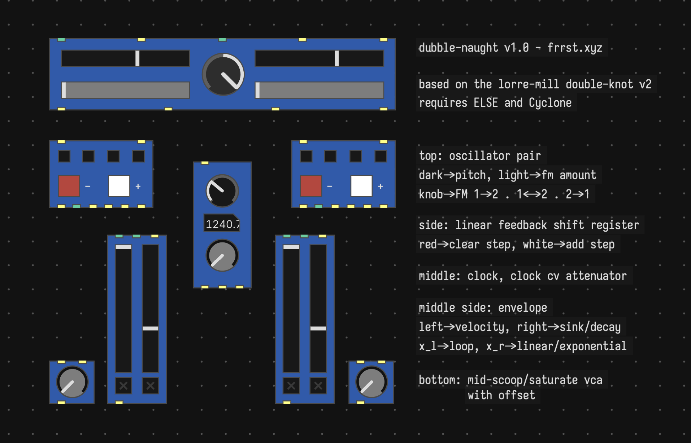

# Dubble Naught

A simulation of the Lorre-Mill [Double-Knot v2](https://lorre-mill.com/doubleknot_V2/) in [Plugdata](https://plugdata.org/) / [Pure Data](https://puredata.info).

Requires ELSE/Cyclone (Built into Plugdata, download from Deken in PD Vanilla).

A real double-knot it is not, but a fair approximation I think it be.
